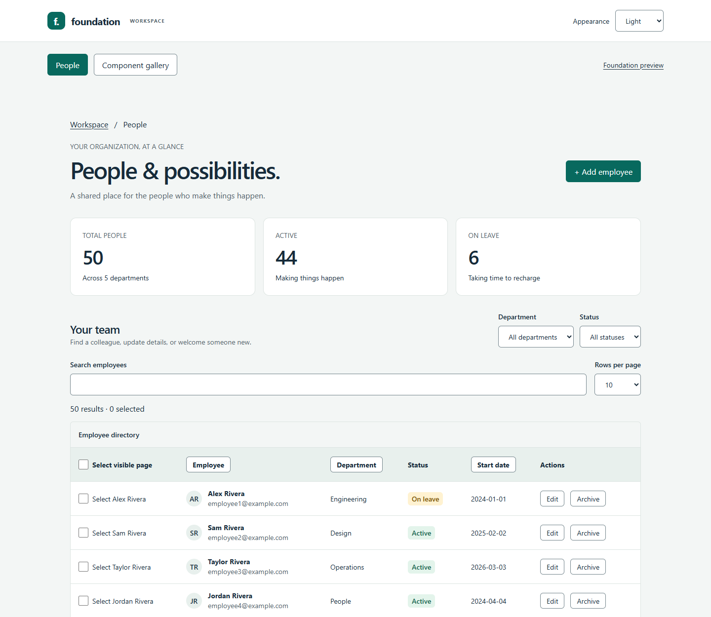
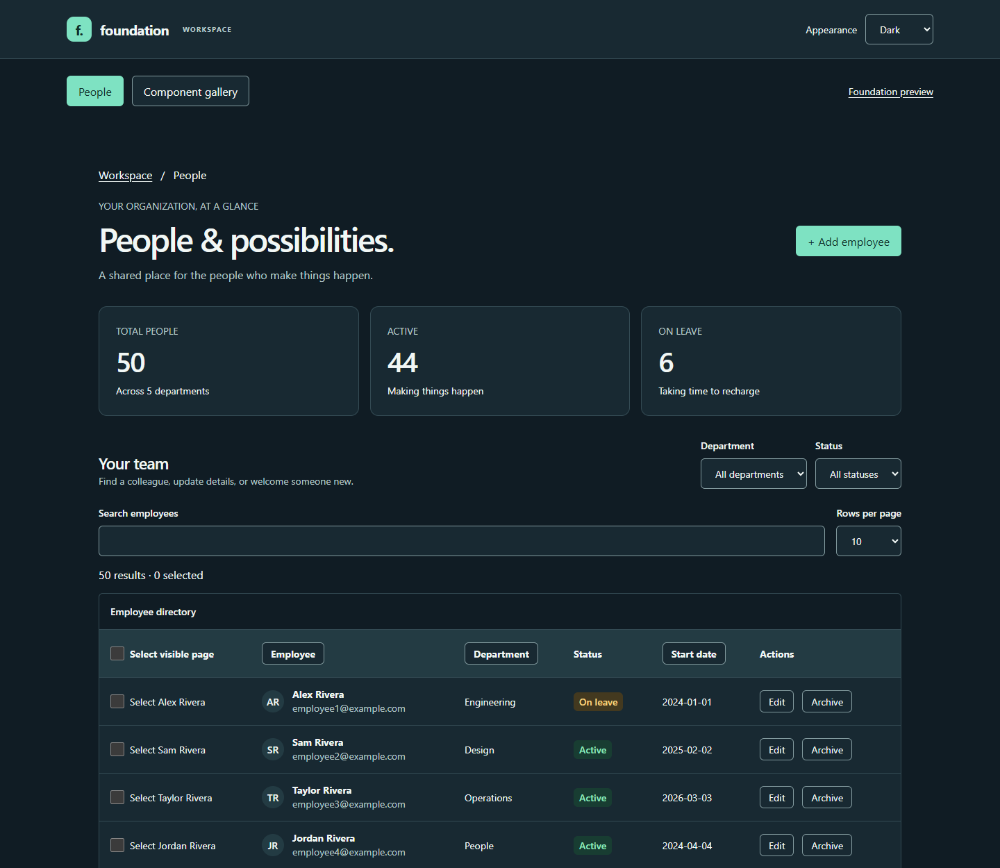
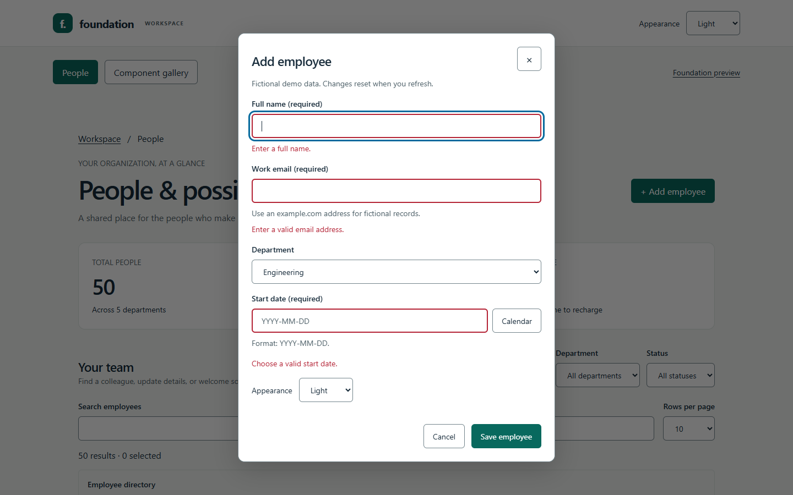
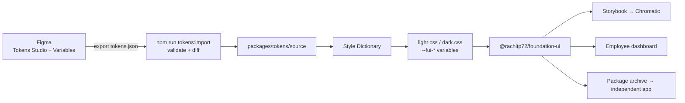
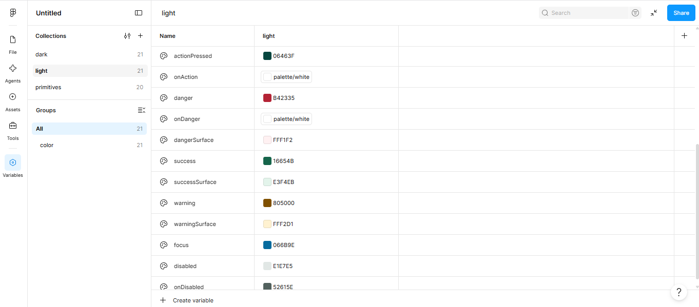
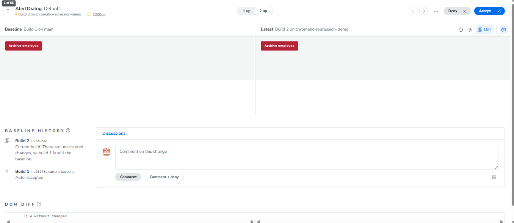

# Foundation UI

An accessible, token-driven React component library: **44 components**, light and dark
themes generated from **Figma** through **Style Dictionary**, documented in **Storybook**,
visually tested with **Chromatic**, and proven in a working **employee dashboard**.

**[Live demo](https://rachit1234766.github.io/F3-02/)** · **[Live Storybook](https://main--6adb1ea72d119416b1620b45.chromatic.com/)** · **[npm](https://www.npmjs.com/package/@rachitp72/foundation-ui)** ·
**[Figma tokens file](https://www.figma.com/design/SP7lRRZBFGGODBBi8uLCDk/I01)** ·
[Test results](docs/test-results.md) · [Component inventory](docs/component-inventory.md)



## Highlights

- **44 components**, from Button and Input to DataGrid, DatePicker, Combobox and Toast,
  each with Storybook stories, including dark and narrow-layout examples.
- **Design tokens from Figma.** Colours, spacing, radius and typography live in Figma
  (Tokens Studio + Figma Variables). One command imports the export, and Style
  Dictionary turns it into theme CSS. A change made in Figma was verified in the app.
- **Accessibility first.** Targets WCAG 2.2 AA: labelled fields, announced errors,
  focus trapping and restoring dialogs, keyboard-operable menus, tabs, calendar and
  combobox. axe runs in unit tests and in real Chrome in both themes.
- **Tested at every level.** 67 behaviour tests (Jest + Testing Library) with 97% line
  coverage, 12 keyboard interaction tests in Storybook, axe on every story in Chrome,
  browser workflow tests, Chromatic visual snapshots, and a check that
  installs the packed library into a separate app.
- **Fast and light.** Lighthouse scores of 100 for performance, accessibility, best practices and SEO; DataGrid stays responsive with 10,000 rows. Ships compiled CSS (no Tailwind setup needed) and one ES module
  per component, so an app importing only `Button` doesn't bundle the calendar.

| Dark theme                                               | Accessible form validation                                               |
| -------------------------------------------------------- | ------------------------------------------------------------------------ |
|  |  |

## Quick start

Requires **Node 24** (see `.nvmrc`) and npm 10+.

```powershell
npm ci
npm run dev:demo     # employee dashboard → http://127.0.0.1:5173
npm run dev          # Storybook          → http://localhost:6006
```

`dev:demo` builds the tokens and the library first, because the dashboard consumes the
library exactly as an external app would: by package name and compiled stylesheet.

## Using the library

Published on npm as [`@rachitp72/foundation-ui`](https://www.npmjs.com/package/@rachitp72/foundation-ui)
(MIT licence):

```sh
npm install @rachitp72/foundation-ui
```

```tsx
import { Button, DatePicker, FormField, Input } from '@rachitp72/foundation-ui';
import '@rachitp72/foundation-ui/styles.css';

export function NewStarter() {
  return (
    <form data-ui-theme="light">
      <FormField id="name" label="Full name" help="As it appears on payroll." required>
        {(props) => <Input {...props} name="name" autoComplete="name" />}
      </FormField>
      <DatePicker id="start" label="Start date" min="2026-01-01" />
      <Button type="submit">Save</Button>
    </form>
  );
}
```

Peer dependencies: React and ReactDOM 19. Consumers need nothing else: no Tailwind
config, Style Dictionary or source aliases.

## Components

| Group          | Components                                                                                                     |
| -------------- | -------------------------------------------------------------------------------------------------------------- |
| Basics         | Button, IconButton, Link, Text, Heading, Badge, Avatar, Separator, Spinner, Skeleton, Progress, VisuallyHidden |
| Layout         | Box, Stack, Grid, Container, Card                                                                              |
| Forms          | Input, Textarea, Checkbox, RadioGroup, Switch, Select, FormField, Fieldset, SearchInput, Slider                |
| Navigation     | Tabs, Accordion, Breadcrumbs, Pagination, DropdownMenu                                                         |
| Overlays       | Modal, AlertDialog, Drawer, Tooltip, Popover, Toast (`ToastProvider` / `useToast`), Alert                      |
| Data and dates | Table, DataGrid (sort, search, paging, row selection), Calendar, DatePicker, Combobox                          |

Per-component status (stories, tests, axe, manual review): [component inventory](docs/component-inventory.md).

## Design tokens: Figma → code



1. Edit tokens in Figma with the Tokens Studio plugin and export a single file.
2. Save it as `packages/tokens/figma/tokens.json` and run `npm run tokens:import`.
   It validates references and types and prints every changed value.
3. `npm run check` rebuilds the CSS through Style Dictionary and reruns contrast and tests.



Step-by-step guide for designers: [docs/figma-guide.md](docs/figma-guide.md).
Token provenance: [packages/tokens/source/README.md](packages/tokens/source/README.md).

## Theming

Set `data-ui-theme="light"` or `"dark"` on any container; themes can be nested.
Dialogs, menus and other portalled overlays follow the theme of the element that
opened them. Every colour is a semantic CSS variable (such as `--fui-color-action`),
so a host app can override tokens on its own container. Tailwind is compiled inside
the library with a `fui:` prefix and no global reset, so host styles are untouched.

## Quality and testing

| Check                       | Result                                                                                                                                                                                                                                                                                                     |
| --------------------------- | ---------------------------------------------------------------------------------------------------------------------------------------------------------------------------------------------------------------------------------------------------------------------------------------------------------- |
| Behaviour tests             | 72 Jest + Testing Library tests; coverage 97.4% statements, 90.4% branches, 98.4% lines                                                                                                                                                                                                                    |
| Tokens                      | 10 validation and Figma round-trip tests; 28 colour pairs meet their contrast targets                                                                                                                                                                                                                      |
| Browser workflows           | Add, edit, archive and undo; grid search, sort, paging and selection; nested calendar dialog; focus trap and restore; 320px reflow; reduced motion                                                                                                                                                         |
| Interaction tests           | 13 Storybook play-function tests (keyboard, focus trap and restore, selection and bulk actions, dates) pass in Chrome                                                                                                                                                                                      |
| Automated accessibility     | axe on all 204 stories in Chrome (0 violations), in Jest, and on the dashboard, gallery and open overlays in both themes                                                                                                                                                                                   |
| Visual regression           | Chromatic snapshots of every story, including open dialogs, menus and calendars. A deliberate one-line CSS regression was caught in 57 snapshots, reviewed and denied                                                                                                                                      |
| Package                     | Packed archive installed, type-checked, built and exercised in a separate app; Button-only bundle contains no calendar code                                                                                                                                                                                |
| Performance                 | Lighthouse 100 / 100 / 100 / 100 on desktop (99 performance on mobile). DataGrid with 10,000 rows updates in under 6 ms, search included (0.2.0, 2020 laptop CPU; [before and after](docs/test-results.md#datagrid-020-memoisation)). Button adds 0.3 KB to an app, DataGrid 3.0 KB, with budgets enforced |
| Manual screen-reader review | NVDA 2026.3 in Chrome on the employee dashboard: 18 of 18 checks pass, covering forms, dialogs, the calendar, the table, announcements and 400% zoom ([manual review](docs/manual-review.md))                                                                                                              |



Full numbers, environment and the history of defects found and fixed:
[docs/test-results.md](docs/test-results.md). Automated results are evidence, not a
WCAG certification; the manual review covers what tools cannot.

## Project structure

```
packages/
  tokens/        Figma import, validation and Style Dictionary build
  ui/            the component library (src/components/*, one folder per component)
apps/
  demo/          employee dashboard, component gallery and foundation workbench
scripts/         browser, contrast, package and Chromatic checks
docs/            architecture, API, decisions, test results, guides
```

## Commands

| Command                       | What it does                                                       |
| ----------------------------- | ------------------------------------------------------------------ |
| `npm run dev:demo`            | Build the library, then serve the employee dashboard               |
| `npm run dev`                 | Storybook development server                                       |
| `npm run check`               | Lint, typecheck, token and contrast tests, Jest, production builds |
| `npm run test:coverage`       | Jest with coverage report in `coverage/`                           |
| `npm run test:browser`        | Browser workflows and axe scans in Chrome or Edge                  |
| `npm run test:storybook`      | Interaction tests and axe on every story (after `build:storybook`) |
| `npm run perf`                | DataGrid speed with 100 / 1,000 / 10,000 rows in Chrome            |
| `npm run perf:lighthouse`     | Lighthouse scores for the dashboard, desktop and mobile            |
| `npm run pack:check`          | Pack the library and verify it in an independent app               |
| `npm run build:storybook`     | Static Storybook in `packages/ui/storybook-static`                 |
| `npm run chromatic`           | Upload Storybook to Chromatic (needs `CHROMATIC_PROJECT_TOKEN`)    |
| `npm run tokens:import`       | Import a Tokens Studio export from Figma                           |
| `npm run tokens:figma-export` | Write the current tokens as a file Tokens Studio can load          |
| `npm run format`              | Format with Prettier                                               |

## Project status

| Area                              | Status                                                                                                |
| --------------------------------- | ----------------------------------------------------------------------------------------------------- |
| Components, stories, tests        | Done                                                                                                  |
| Figma tokens and Style Dictionary | Done                                                                                                  |
| Light and dark themes             | Done                                                                                                  |
| Chromatic visual testing          | Done                                                                                                  |
| Manual NVDA review                | Done: 18 of 18 checks pass                                                                            |
| Registry publication (semver)     | Published: `@rachitp72/foundation-ui@0.2.0` (MIT); 0.1.0 before it ([release notes](docs/release.md)) |
| Hosted demo                       | Live on GitHub Pages: https://rachit1234766.github.io/F3-02/ (redeployed on every push to `main`)     |

Full status and next steps: [PROJECT-STATUS.md](PROJECT-STATUS.md). More detail: [architecture](docs/architecture.md),
[API](docs/api.md), [decisions](docs/decisions.md), [release checklist](docs/release.md).

## Built with

React 19, TypeScript, Vite, Tailwind CSS 4, Radix UI primitives, react-day-picker,
Style Dictionary, Tokens Studio for Figma, Storybook 10, Chromatic, Jest, Testing
Library, axe-core and Puppeteer. All employee data in the demo is fictional.
