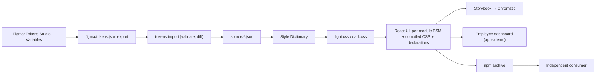

# Architecture

## Packages

- **`packages/tokens`** (private): `figma-import.mjs` converts a Tokens Studio export
  into the Style Dictionary `value`/`type` schema, `validate.mjs` checks references,
  cycles, types and matching light/dark keys, and `build.mjs` emits namespaced
  `--fui-*` variables per theme. It has no runtime dependency on the UI.
- **`packages/ui`** (`@rachitp72/foundation-ui`): 44 components. Vite builds one ES module
  per source module (`preserveModules`) so consumers tree-shake unused components and
  their runtimes; React, Radix and react-day-picker stay external. TypeScript emits
  declarations separately. Tailwind is compiled into a single stylesheet with a `fui:`
  prefix and no Preflight, so host styles are untouched.
- **`apps/demo`**: the employee dashboard, a component gallery and the original
  foundation workbench (`?view=foundation`). It imports the library by package name
  and compiled stylesheet, never from `packages/ui/src`, which proves the public exports.

## Key decisions

- **Interaction primitives.** Dialogs, menus, popovers, tooltips, tabs, accordion and
  toast use Radix primitives for focus management and keyboard behaviour; Calendar
  uses react-day-picker. The library wraps them in its own typed APIs and styles.
- **Theme across portals.** Overlays are portalled to `<body>`; `usePortalTheme`
  reads the theme of the element that opened them, so a dark section opens dark popups
  inside a light page.
- **Controlled and uncontrolled inputs.** `useControllable` lets each input accept
  either `value` + `onValueChange` or `defaultValue`; in controlled mode the owner's
  value always wins, even when it rejects a change.
- **Date-only values.** Dates are `YYYY-MM-DD` strings parsed at local noon, never
  through UTC, so a date cannot shift by a day across timezones; impossible dates such
  as 2026-02-31 are rejected rather than normalised.
- **DropdownMenu is non-modal.** A modal menu hides the page from assistive technology
  while it stays focusable; Escape and outside clicks still close it.

## Demo data

Fictional employees with stable string IDs, `example.com` email addresses and date-only
start dates live in React state. Changes reset on refresh; there is no backend,
authentication, persistence or external submission.

More: [API](api.md), [decisions](decisions.md), [test results](test-results.md).
